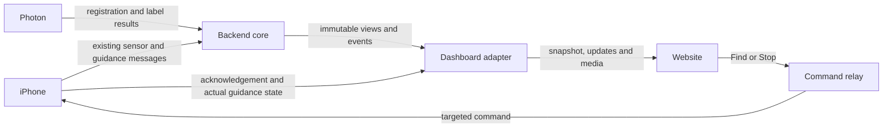

# Dashboard API integration plan

Status: **prepared, implementation not started; ownership undecided**. Written October 17, 2026 against main at `755ee6b` and the current local frontend/iOS changes. Recheck this plan against the backend team's final code before starting.

Rebaseline note: the subsequent team push at `71268c6` implements `photon/` on Photon 2.0 using the existing §5 interfaces. Its server routes and loopback security are reconciled. Dashboard registration progress still depends on actual bridge lifecycle events; the existing label/item results can be reused.

The frontend/iOS changes were subsequently rebased onto backend `8aa0ae1`, including its floor-relative surface and range handling. That core remains authoritative; the browser adapter is still planned.

## 1. What we would take on

Add the API layer that connects the existing website to the backend team's finished core. Keep perception, touch detection, object identity and world memory in that core. Keep camera capture, voice commands and spatial audio in the iPhone app.

The deliverable is a working flow: a real item appears on the website, Find starts guidance on the connected phone, Stop ends guidance, and the website reflects actual phone state. Registration remains through Photon. Ownership of this integration can stay with the backend team or move to us without changing that design.

**Scope for the hackathon:** one active phone/session, one room, the existing Objects and Live screens. No database migration, second world model, new detection model, full room reconstruction, or redesign is needed to connect them. Server-restart persistence is a separate decision, not something these endpoints provide automatically.

## 2. Use the current sources of truth

| Source                                                                                       | Use it for                                                        |
| -------------------------------------------------------------------------------------------- | ----------------------------------------------------------------- |
| [Team interfaces](../../docs/INTERFACES.md) and actual `server/` implementation              | Device/server ownership, geometry, existing messages and routes   |
| [Browser schema](../src/lib/schema.ts)                                                       | Exact payload the website currently accepts                       |
| [Example](dashboard.snapshot.example.json) and [JSON Schema](dashboard.snapshot.schema.json) | Contract fixtures and interoperability checks                     |
| [Minimum handoff](fastapi-handoff.md)                                                        | Existing browser transport, freshness and command behavior        |
| [Audit fixes](audit-fixes.md)                                                                | Map identity, session replacement and reconnect cases to preserve |

The [older frontend contract](frontend-backend-contract.md) describes a POC-era split in which the phone owns world memory and 3D placement. **That ownership diagram is superseded by the current team interfaces and backend.** Retain its browser field definitions where they match the schema; do not implement its old architecture.

This file proposes work. It does not amend the device protocol. When implementing new messages, update `docs/INTERFACES.md`, regenerate its `.docx` with `poc/tools/md2docx.py`, and change the corresponding sender, receiver and contract tests together. Record the final owner handoff in the repo.

## 3. What exists and what is missing

| Area                  | Already present                                                        | Integration work                                                                                 |
| --------------------- | ---------------------------------------------------------------------- | ------------------------------------------------------------------------------------------------ |
| Sensor ingestion      | `POST /v1/frames`, `WS /v1/phone`                                      | Reuse; retain frame metadata when projecting dashboard state                                     |
| Perception and memory | `RealBrain`, `World`, `RoomMap`; stub for development                  | Read their outputs; do not repeat their logic                                                    |
| Dashboard feed        | `WS /v1/dashboard`: world, frame, map points, guidance, timeline       | Translate into the browser's complete snapshot format                                            |
| Items and labels      | `/v1/items`, `/v1/labels`, `/v1/timeline`; audio and touch-crop routes | Adapt metadata/media and the implemented Photon 2.0 results                                      |
| Website APIs          | API client, validation, reconnects and command UI implemented          | Three browser routes below are still absent from FastAPI                                         |
| Find/Stop             | Phone voice Find and `AppModel.stopGuidance()`                         | Dashboard command relay, explicit phone acknowledgement and correlation                          |
| Phone routing         | `Hub` broadcasts to a channel of sockets                               | Bind the active device/session to its socket; commands must target that socket                   |
| Health                | Phone has local camera, tracking and audio status                      | Send a small explicit status message; current server messages do not fully describe these states |

Adding route functions alone will not complete Find/Stop. The current Swift decoder does not handle a dashboard command, and the server has no command acknowledgement message or stable device-to-socket binding.

## 4. Agree these details when the core is ready

These are handoff inputs, not reasons to stop preparation now.

| Decision                                       | Recommended starting point                                                                                                                                                                                              |
| ---------------------------------------------- | ----------------------------------------------------------------------------------------------------------------------------------------------------------------------------------------------------------------------- |
| Who implements the adapter?                    | Us if the backend owner hands it over; backend owner reviews the core access points. iOS owner coordinates the phone message changes.                                                                                   |
| How do we read core state?                     | An immutable view plus events from the running core, inside the same FastAPI process. No HTTP requests back into our own server.                                                                                        |
| Which phone is controlled?                     | Explicitly selected single demo device/session. Agree a stable app device ID and bind it to an authenticated socket. Do not identify it by model name.                                                                  |
| How is session replacement rejected?           | Add `sessionId` to the browser command body in a coordinated update. It currently sends only `deviceId`; that cannot distinguish an old request arriving after the same device starts a new session.                    |
| What identifies the room?                      | A configured demo room ID/name; use actual map IDs for coordinate validity. A friendly room name is not evidence of relocalization.                                                                                     |
| Which Photon service runs?                     | `photon/` now implements Photon 2.0 and §5. Use it for the demo; confirm which lifecycle events are observable by the dashboard.                                                                                        |
| What must survive a restart?                   | First milestone can use current process state. If restart persistence is required, ask the core owner for restore/storage behavior and test it separately. Recordings on disk are not automatic live-state restoration. |
| How does browser authentication reach FastAPI? | One authenticated origin through Tailscale Serve and a loopback proxy that preserves trusted identity for HTTP, WS and media.                                                                                           |

Until these are settled, read-only APIs can proceed using available observations. Keep controls unavailable where the phone or location cannot be verified. Missing optional data should stay empty/null.

## 5. Proposed implementation



Start with small modules, for example `server/marco/dashboard.py` for the read model/routes and `server/marco/dashboard_commands.py` for commands. These filenames are suggestions. Extend `app.py` only at ingestion, dispatch, connection lifecycle and route registration; extend `hub.py` or add a small registry for targeted delivery.

The adapter keeps a bounded view of current state, not another perception engine. Capture immutable outputs at agreed core boundaries: inference runs in a worker thread and phone messages may arrive concurrently, so do not serialize mutable core objects while another handler changes them. Keep browser publishing outside inference and outside locks needed by capture/touch. Each browser gets a bounded latest-snapshot queue; a slow browser must not hold up the phone pipeline.

### Browser routes

Paths below are FastAPI paths. The website calls them under `/api`; the existing development proxy strips that prefix.

| Route                      | Behavior                                                                                                                                       |
| -------------------------- | ---------------------------------------------------------------------------------------------------------------------------------------------- |
| `GET /dashboard/snapshot`  | Return one complete schema-valid snapshot of current state                                                                                     |
| `WS /events`               | Send current state immediately, then a complete snapshot at least once per second, including while observations are unchanged                  |
| `POST /dashboard/commands` | Validate Find/Stop, reserve/deduplicate the command, relay to the bound phone, return HTTP 202 with matching `commandId` and `status: pending` |
| `GET /media/...`           | Authenticated aliases for immutable frame JPEGs, available item photos and label audio                                                         |

Retain existing `/v1` routes for the phone and Photon. Every snapshot has `schemaVersion: 1`, a process/stream ID, a strictly increasing sequence and UTC `sentAt`. Increment sequence for heartbeat snapshots too. Change stream ID whenever sequence resets. GET and WS must share the same sequence allocator so a fetch followed by socket connection cannot regress state.

### Map backend data into the existing schema

| Browser field                 | Source and handling                                                                                                                                                                                                                                                   |
| ----------------------------- | --------------------------------------------------------------------------------------------------------------------------------------------------------------------------------------------------------------------------------------------------------------------- |
| `session`                     | Bound phone session, agreed device ID, configured room metadata and observed map lifecycle. Before a phone is bound, use an explicitly inactive scope with controls disabled, not a pretend connected device.                                                         |
| `items`                       | `brain.items_public()` / world snapshot. Translate `item_id` to `id`, position arrays to `{x,y,z}`, `last_seen_wall` to `lastSeen.at`. Keep items when they leave the camera view.                                                                                    |
| `items[].lastSeen.worldMapId` | Record the map associated with the sighting. Current public items do not expose a per-item map ID: preserve that association at the core boundary. Never stamp every old position with the newest map ID.                                                             |
| `wearer`                      | Latest valid pose: translation and body heading from the column-major transform; head yaw from pose telemetry. Discard out-of-order device timestamps within the session.                                                                                             |
| `map`                         | Measured active-map extents, or bounds covering valid observed positions with display padding. `walls: null`, fixtures omitted unless actually measured. Bounds do not imply known walls or a walkable route. Return `map: null` if no valid coordinate frame exists. |
| `camera`                      | Existing upright `frame` output. Cache its JPEG once, measure its upright dimensions, and pair its frame ID, capture time and boxes atomically. Include only detections the core marks present; preserve upright pixel coordinates.                                   |
| `navigation`                  | Actual phone guidance telemetry: behind/turning/facing/approach → guiding; reach → within_reach; touched → found; off → idle. Map beacon/steady/confirmation only when supported by the phone's phase. Suppress current cues on missing/stale input.                  |
| `spokenInstruction`           | Exact phrase from phone telemetry if added; otherwise null. Current guidance messages do not contain the spoken sentence. Do not present a browser-generated phrase as something the user heard.                                                                      |
| `devices.phone`               | Socket lifecycle plus recent phone status/telemetry. Tracking limitations need explicit status: pose silence alone does not tell us why tracking stopped.                                                                                                             |
| `devices.airpods`             | Explicit phone audio-route health. `head_source: fusion` and an OS spatial-audio capability flag do not prove that a particular headphone is currently connected. Use unknown until reported.                                                                         |
| `voiceLabel`                  | Existing text/audio plus the label event's creation time. Unknown author and duration stay null. Missing registered-item photos stay null until the core/adapter retains and serves them.                                                                             |
| `registrations`               | Actual Photon request/result events, correlated by request/touch/item ID. Start with `[]` if the bridge exposes no lifecycle; do not invent photo/processing stages. Publish saved label and updated item together.                                                   |
| `recentMemory`                | Stable IDs assigned once to core events: seen → seen; moved/put_down → moved; label_added → label_saved. Retain a bounded newest-first history so reconnecting clients recover it.                                                                                    |
| `lastCommand`                 | Matching command ID plus phone-confirmed outcome, from the relay's command record                                                                                                                                                                                     |

Use actual capture/event wall times where available. `t_device` is uptime, not a Unix timestamp. Where a message has no wall time, document receipt-time semantics and keep a separate monotonic freshness timer; do not refresh pose, navigation or last-seen timestamps just because a new browser snapshot was emitted.

On a new map, invalidate old live coordinates, guidance and camera context. Preserve remembered descriptions, retaining old map associations or nulling unusable positions. Clear map bounds accumulated for the old frame. The current `World.snapshot()` alone omits map IDs, and room-map data needs explicit lifecycle handling; agree those access points with the core owner.

### Camera and media

Cache the already-upright display JPEG, not the original sensor image with new boxes layered over it. Use immutable session/frame URLs, retain them for at least 10 seconds and a small bounded grace window, then expire them. A new session may reuse numeric frame IDs, so `frameId` alone is not a media cache key.

The existing `/v1/dashboard` feed includes base64 JPEGs. Decode/cache once at the adapter boundary; do not include those bytes in every full browser snapshot. No second detector, video transcoder or high-rate video service is needed for the one-frame-per-second demo.

Prefer `/media/...` aliases in snapshots: the browser already rewrites those to `/api/media/...`. Existing `/v1/audio/...` paths are not rewritten by `mediaUrl()`, so passing them straight through would need an explicit proxy/client change. Confirm images and audio load with the same auth as API requests, including requests made by native `` and `<audio>` elements. Convert caretaker audio only if the actual browser/phone cannot play its format.

### Find/Stop and the small iOS extension

Agree the exact new messages in the team interfaces before coding. The required information is:

- Phone status/binding: device ID, session ID, tracking and current audio-route state. Send about once per second even when AR tracking is limited, so a connected phone is not mistaken for a dead connection.
- Server command: command ID, bound session, action, selected item ID and deadline. Find must resolve that exact registered item, not a fuzzy name match that could choose another jar.
- Phone acknowledgement: matching command/session IDs and accepted/applied/rejected result with a reason. Define how applied maps to the browser's `completed` status.

Implementation sequence:

1. Browser generates an ID and posts Find/Stop. Add the agreed session ID to both its command type and server validation together.
2. Server verifies auth, active device/session, freshness and one in-flight command. Find additionally requires an existing item with usable current-map location. Reserve the ID before sending so retries cannot execute it twice.
3. Route only to the bound socket. A replacement socket invalidates the old connection generation. Do not call the current channel-wide `hub.send("phone", ...)` for a dashboard command.
4. iOS validates session/deadline and deduplicates the command. Find reuses the existing target/guidance setup with the core's exact-item result. Stop calls `stopGuidance()`; it does not turn off the camera/control panel.
5. Publish `accepted` only after an explicit affirmative phone response. HTTP 202 means delivery is pending. `completed` means the requested action was applied: guidance started or stopped. It does not mean the user found the item; `navigation.state: found` comes from the phone's actual touch/guidance flow.
6. Project subsequent phone telemetry, including guidance started by voice. The dashboard must also follow actions that did not originate in the browser.

Keep a bounded command-result cache for the demo session. Same ID and same request returns the cached pending/outcome without another action; conflicting reuse returns 409. Retain the active/most recent result in snapshots so a lost HTTP reply can be recovered. Clear active scope on session replacement; never replay an old command when a phone reconnects.

The browser already times out after 10 seconds and retries uncertain requests with the same ID. Expire undelivered commands; a phone must reject an expired command rather than start it late. **A sent command with a lost acknowledgement has an uncertain outcome.** Agree how that is represented before implementation; do not report that audio definitely stopped or guidance definitely never began. Reconcile late acknowledgements/telemetry without executing the action again. Allow Stop to supersede an unresolved Find, with cancellation recorded so that Find cannot later restart guidance.

Use the existing stable command errors: 400 invalid request, 401/403 denied, 404 unknown item, 409 busy/disconnected/session or location mismatch. Example body: `{"error":{"code":"phone_disconnected","message":"iPhone is disconnected."}}`. Keep existing `/v1` validation/auth behavior intact rather than globally replacing FastAPI error handling.

## 6. Build in small, demonstrable steps

| Step                     | Work                                                                                                                                                      | Done when                                                                                  |
| ------------------------ | --------------------------------------------------------------------------------------------------------------------------------------------------------- | ------------------------------------------------------------------------------------------ |
| 0. Rebaseline            | Fetch the backend team's final changes without discarding local work; record commit, run its current tests, agree the inputs in §4 and core access points | We know the real routes, owners and data shapes; no duplicate endpoints                    |
| 1. Read-only integration | Add read model, GET and WS; map items, session, pose, map validity, history and real health                                                               | Website in API mode updates from the running server and reconnects without demo fallback   |
| 2. Camera and labels     | Add authenticated media cache/aliases, paired frame/boxes and available Photon results                                                                    | Actual upright frame renders correctly; available labels play and update the right item    |
| 3. Find/Stop             | Update team protocol + both implementations/tests; add registry, deduplication, deadlines and phone acknowledgement                                       | Find starts real phone guidance; Stop ends it; disconnected/invalid commands are explained |
| 4. Demo verification     | Run live-server browser checks, existing regressions and physical phone session; document missing optional data                                           | End-to-end flow works on the venue setup, with clear limits                                |

If time is tight, finish items/history and Find/Stop before map decoration or extra registration progress stages. Camera can be delivered as the existing one-frame-per-second feed. Keep 3D room rendering for the recorded demo video, as already planned.

## 7. Tests to add when implementing

| Test group   | Required evidence                                                                                                                                                                                                                            |
| ------------ | -------------------------------------------------------------------------------------------------------------------------------------------------------------------------------------------------------------------------------------------- |
| Contract     | Validate real server output against the exported JSON Schema **and** browser Zod runtime (including bounds/box refinements). Null/empty data, full replacements and timestamp rules pass.                                                    |
| Streaming    | GET then WS cannot roll back state; WS sends immediately; heartbeat sequences progress without new frames; reconnect restores state/history; slow clients do not block ingestion.                                                            |
| Coordinates  | Same-map wearer/item works; map reset and relocalization cannot reuse invalid positions; old frame/pose cannot overwrite a newer one.                                                                                                        |
| Camera/media | Rotated sensor input produces upright image and matching boxes; frame ID reuse across sessions is safe; media survives its promised window and fails cleanly after expiry.                                                                   |
| Commands     | Correct socket/item; accepted only after phone ack; Stop stops guidance only; duplicate HTTP requests/lost replies run once; conflicting IDs, timeout, late ack, expired delivery, old session/socket and Stop superseding Find are covered. |
| Health       | Tracking limited/relocalizing remains distinguishable from disconnected; actual headphone route reported; heartbeat snapshots cannot make stale sensor state look fresh.                                                                     |
| Photon       | Saved item/label arrive together; failed/retake results only appear if the bridge really emits them; unknown lifecycle remains empty.                                                                                                        |
| Access       | Existing allow-list applies to new HTTP, WebSocket and media routes. Unauthorized access is rejected, including bad WS origins where applicable.                                                                                             |

Add a separate browser integration run against **real FastAPI routes**, with `VITE_DATA_SOURCE=api` and no Playwright HTTP/WS interception. Existing `frontend/tests/api.spec.ts` uses mocked routes and does not prove the adapter works. Use an explicit phone protocol test client first, then the real app; server stub mode helps test plumbing but does not prove perception or physical audio.

Run the affected suites, from the repo root unless `cd` is shown:

```sh
cd server
../poc/.venv/bin/python -m pytest -q tests
```

```sh
sh ios/check.sh
```

```sh
cd frontend
npm run check
```

If Photon code/messages change, run `npm test` in `photon-scaffold/` plus the selected real bridge's checks. Build the canonical `ios/MarcoPolo.xcodeproj` / `MarcoPolo` scheme in Xcode for changes to ARKit/UIKit/AppModel; the portable Swift checks do not compile those files. Re-run the venue frame benchmark if detection changes, and measure that dashboard publishing does not push the pipeline over its one-second budget.

## 8. Deployment and final demo check

Keep the server bound to `127.0.0.1` and preserve `marco/auth.py`. Serve the built website and `/api` HTTP/WS/media through one loopback reverse proxy behind Tailscale Serve; retain `/v1` routing for existing clients. Forward the authenticated Serve identity to FastAPI. The local Vite proxy alone does not supply that identity. Do not use the test auth bypass for the remote demo or add shared keys to work around access failures.

Before calling integration done:

- [ ] Real phone connects; website shows actual health and current-map position.
- [ ] A registered item appears, leaves view and remains remembered. Moving it updates memory only after the core observes it again; nothing claims to track unseen movement behind the wearer.
- [ ] Camera image and boxes agree on upright orientation and frame.
- [ ] Find starts guidance on the intended phone/item; Stop ends guidance while capture stays running.
- [ ] Disconnect, tracking loss, map reset, phone restart and browser reconnect produce honest states; uncertain retries do not execute twice.
- [ ] A real Photon label updates the item and plays through authenticated media, or the missing bridge integration is recorded explicitly.
- [ ] Phone audio, LiDAR, VoiceOver and route behavior are checked on hardware. Simulator/build success alone does not verify them.
- [ ] Record commit, test results, launch/proxy instructions and remaining limits in `STATUS.md`; replace outdated ownership notes after the team agrees them.

This preparation adds documentation only. No backend endpoints, phone messages, deployment, commits or pushes are included.
