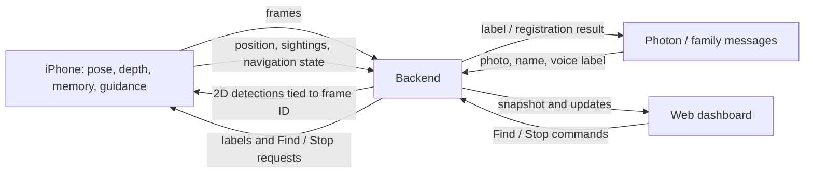

# Marco Polo: frontend / backend contract

Status: **frontend implemented against v0.1; FastAPI API pending**, 2026-10-17. See [the short backend handoff](fastapi-handoff.md) and [frontend run instructions](../README.md). The existing prototype does not implement the dashboard endpoints yet.

**Architecture update:** the current `server/` owns 3D placement and world memory under [the team interfaces](../../docs/INTERFACES.md). The POC inventory and ownership diagram below predate that implementation. Use [the backend integration plan](backend-integration-plan.md) for current ownership and access points, and [the browser schema](../src/lib/schema.ts) for implemented payloads.

## 1. Build against a shared contract

Neither the frontend nor the backend should dictate the other's internals. Agree on the messages below, then work in parallel:

- Frontend: render the example payload and wire the controls.
- Backend: produce the same payload from storage, Photon, and the phone.
- iPhone: supply tracking, spatial memory, camera frames, and actual navigation state.

The contract describes what crosses these boundaries. It does not prescribe the database schema or require a production messaging system.

**Registration decision:** adding and labeling objects goes through **Photon**. The dashboard observes that flow. Keep the app-based upload/name designs in Paper; they are outside the initial frontend implementation scope.

Design reference: [Marco Polo in Paper](https://app.paper.design/file/01M55Z1GDRDK8E0XJMJE99EECZ/p-1-0).

## 2. Ownership



| Component | Owns                                                                                                                | Does not need to do                                                       |
| --------- | ------------------------------------------------------------------------------------------------------------------- | ------------------------------------------------------------------------- |
| iPhone    | World coordinates, relocalization, last-seen observations, head/body direction, audio, within-reach and found state | Render the dashboard                                                      |
| Backend   | Detection, persistent metadata/history, Photon adapter, media access, current session snapshot, command relay       | Infer 3D locations from a 2D box alone                                    |
| Dashboard | Objects / Live views, selected item, Map / Camera switch, visual overlays, connection feedback                      | Run LiDAR, detect touch, calculate spatial audio, or invent a found event |

The browser mirrors the phone's spoken instruction; it does not automatically play a second copy. Playing a family voice label on the dashboard is an explicit user action, and so is **Listen in** on the Live page, which plays what the phone reports in `dashboard.sound` (below), from the same directions. Captions are always the phone's own words.

## 3. What exists versus what needs building

The inspected prototype is [`poc/pocs/poc26_server/app.py`](../../poc/pocs/poc26_server/app.py).

| Interface                                              | Current state                                                         |
| ------------------------------------------------------ | --------------------------------------------------------------------- |
| `POST /items`                                          | Prototype: photo + name registration; returns quality / retake result |
| `GET /items`                                           | Prototype: returns item IDs and names only                            |
| `POST /frames`                                         | Prototype: returns 2D detections, not a camera stream or room map     |
| Dashboard snapshot, WebSocket, commands, media URLs    | **Proposed below; not implemented**                                   |
| Photon callbacks, stored history, phone telemetry feed | Still need implementation / integration                               |

The prototype's authentication gate currently rejects requests until a verifier is configured. Browser access and WebSocket authentication need wiring before live integration. Do not build the dashboard around the test-only authentication bypass.

## 4. Minimum browser-facing API

Use these unversioned paths for the hackathon to stay consistent with the existing prototype. Payloads carry `schemaVersion: 1`.

| Method | Path                  | Purpose                                                                            |
| ------ | --------------------- | ---------------------------------------------------------------------------------- |
| GET    | `/dashboard/snapshot` | Get the complete current dashboard state                                           |
| WS     | `/events`             | Receive complete `dashboard.snapshot` messages, and `dashboard.sound` between them |
| POST   | `/dashboard/commands` | Request Find or Stop on the phone                                                  |

Image/audio URLs are returned in the snapshot. The frontend treats those URLs as opaque and does not construct storage paths.

**What the wearer hears:** between snapshots, `/events` also carries `dashboard.sound` (`soundSchema` in `src/lib/schema.ts`; the server side is `docs/INTERFACES.md` §6). Each one is either a `cue` (one sound as it starts: `beep`, `ding`, `tone_on`, `tone_off`, `say`, `label`, `blip` or `silence`) or a `field` (10 times a second while anything is audible: where the beacon and the voice are now). Directions are relative to the wearer's head: `azimuthDeg` 0 ahead, +90 right, ±180 behind; `elevationDeg` up; `distanceM` ear to source. They come only from the phone, which renders the sound. A sound from another `streamId`, or a malformed one, is dropped without marking the connection stale, and sounds never count as snapshot progress. `navigation.spokenInstruction` carries the phone's latest `say` line while it plays and for 3 s after.

Current guidance cues also carry optional `variant`: `on_beam`, `off_beam`, `behind`, `here`, `hand_ping` (for `beep`), `arrive` (for `ding`) or `contact` (for `tone_on`). `hand_ping` includes integer `handStep` 0–5, the phone's D5-to-D6 pitch ladder. `Listen in` renders those recipes, distinguishes the arrival triad from the facing double ding, and uses a 1175 Hz contact tone. Missing/null detail keeps the legacy recipe, including the old 660 Hz tone. The exported sound schema accepts both. The server validates the cue/variant/step combination before relaying it. These are synthesized observer cues with browser HRTF and network timing; they are not an exact recording of the AirPods output. Demo mode's older scripted sequence uses the legacy recipes.

**Connection sequence:** fetch the snapshot, render it, then connect the WebSocket. The server immediately sends a fresh full snapshot when a socket connects or reconnects. This closes the gap between the initial fetch and live updates. No event replay system is needed for this build.

Start with full snapshots rather than partial update messages. With one room and a few demo objects, this keeps both implementations simple. Other phone/backend consumers may use the same socket with explicitly different message types; the dashboard handles `dashboard.snapshot` only.

## 5. Snapshot shape

The complete, parseable example is [`dashboard.snapshot.example.json`](./dashboard.snapshot.example.json). Both sides should use it as their initial integration fixture. Example media URLs in that file are illustrative, not working endpoints.

### Envelope

| Field           | Meaning                                                                         |
| --------------- | ------------------------------------------------------------------------------- |
| `type`          | Exactly `dashboard.snapshot`                                                    |
| `schemaVersion` | Exactly `1` for this contract                                                   |
| `streamId`      | Backend-generated ID; changes if the stream's sequence resets                   |
| `sequence`      | Increasing integer within a stream; every published snapshot gets a newer value |
| `sentAt`        | Backend UTC timestamp                                                           |
| `data`          | Complete state described below                                                  |

Ignore a repeated or older sequence within the same stream. A different stream ID replaces the old stream state. Every full snapshot includes every top-level data field; `items`, `registrations`, and `recentMemory` replace their previous arrays rather than being appended.

### Data fields

| Field           | Required content                                                                            |
| --------------- | ------------------------------------------------------------------------------------------- |
| `session`       | `id`, `deviceId`, `roomId`, `roomName`, `worldMapId` (nullable)                             |
| `devices`       | `phone` and `airpods` connection states and last-message times; phone tracking state        |
| `map`           | `null`, or world-map ID, meter bounds, and nullable wall geometry                           |
| `wearer`        | `null`, or observation time, world-map ID, position, body yaw and nullable head yaw         |
| `items`         | Complete registered-object list, including metadata and last-seen information               |
| `camera`        | `null`, or one image with its dimensions, frame ID, and matching boxes                      |
| `navigation`    | Actual phone navigation state, target, distance, bearing, audio pattern, and spoken caption |
| `registrations` | Photon registration/label requests and their current progress                               |
| `recentMemory`  | Recent history records, newest first; filter by item for its detail panel                   |
| `lastCommand`   | `null`, or the latest command ID, status and nullable failure reason                        |

All timestamps use ISO 8601 UTC strings ending in `Z`. Distances and positions are numbers in meters. Use `null` for an unknown optional value, not `0`, an empty string, or invented coordinates. Required field names and enum values are stable; clients may ignore extra fields.

### Object and memory records

- An item has stable `id`, `name`, nullable `photoUrl`, nullable `voiceLabel`, and nullable `lastSeen`.
- `voiceLabel` contains `audioUrl`, `transcript`, `authorName`, `durationSeconds`, and `createdAt`. `audioUrl` is nullable for a text-only label; the author/duration may also be unknown.
- `lastSeen` contains `at`, `roomId`, `roomName`, nullable `surface`, nullable `worldMapId`, and nullable `position`.
- A memory record has stable `id`, `itemId`, `kind`, `at`, and nullable `surface`. Initial kinds: `seen`, `moved`, `label_saved`. The phone supplies `seen` / `moved` observations; the backend supplies label events.
- An object outside the camera remains in `items`. Not seeing it is not proof it moved or disappeared.
- Older observations must not replace a newer `lastSeen`. Surface names are phone/backend metadata; show a room-level fallback if the surface is unknown.

### Coordinates and map

- Positions are `{ "x": number, "y": number, "z": number }` in the phone's saved world frame. Every usable position is associated with a `worldMapId`.
- The top-down view plots world **X horizontally** and world **Z vertically**: increasing X goes right; increasing Z goes down. Y is height. This is a room view, not geographic north.
- Yaw in the dashboard contract is degrees clockwise from world **−Z**: 0 faces up, 90 faces right. The phone converts its native rotations to this convention before publishing.
- Bounds are `minX`, `maxX`, `minZ`, `maxZ`. Optional `walls` are segments with `from` and `to` points containing X/Z. `walls: null` means geometry is unavailable, not that an empty room was scanned.
- Only overlay wearer/items with the same map ID. After a tracking reset or failed relocalization, retain object names and last-seen text, but hide invalid position/direction cues.
- `map: null` is supported. A room mesh or a full LiDAR point cloud is **not required** by the dashboard. The floorplan/furniture drawn in Paper is a visual concept; do not present those shapes as measured geometry without a source.

### Camera and bounding boxes

- `camera.frameId` is the phone's frame ID scoped to the current session/device. `camera.capturedAt` is its capture time.
- `widthPx` / `heightPx` describe the upright JPEG served by `imageUrl`. `boxPx` is `[xMin, yMin, xMax, yMax]` in **that exact image**, before browser scaling or cropping.
- The server's inference response must still be matched to the original phone frame/pose for 3D positioning. The dashboard does not do that conversion.
- Publish an image and its boxes together. Never place a late detection over a newer preview image. Publish no boxes for frames whose detections are not ready.
- Each box entry contains `itemId` and `boxPx`. For example, a frame in which the keys are visible could contain `"boxes": [{ "itemId": "item-keys", "boxPx": [320, 180, 510, 340] }]`. The main example has no boxes because its selected target is behind the wearer.
- The frontend accounts for the preview's scaling and crop offset when drawing a box; it shows only the selected object's box by default.
- Suggested first build: one JPEG preview per second. Pose/guidance updates can arrive faster without sending a new image. Do not put base64 image data in every snapshot.
- Preview frames may be kept briefly in memory for delivery; no video archive is required. Retain the current served frame long enough for a browser to fetch it (proposed: at least 10 seconds). If it has expired, show a waiting state and use the next frame; never reuse its boxes on another frame.

## 6. Navigation state and controls

| `navigation.state` | Dashboard behavior                                          |
| ------------------ | ----------------------------------------------------------- |
| `idle`             | Inspect objects; no active guidance                         |
| `guiding`          | Show target, distance, direction and actual spoken caption  |
| `within_reach`     | Close-range visual and steady-tone caption                  |
| `found`            | “Got it” completion screen                                  |
| `paused`           | Preserve the target but suppress active guidance            |
| `unavailable`      | Explain missing location/tracking; no direction or distance |

`targetItemId` is nullable when idle. `distanceM`, `bearingDeg`, and `spokenInstruction` may be null. `bearingReference` is `head` or `body`, and is null when no bearing is available. `bearingDeg` is relative to that reference: 0 ahead, +90 right, ±180 behind, −90 left. The phone supplies this value; the browser does not independently recreate head fusion.

`audioPattern` is one of `off`, `beacon`, `steady`, `confirmation`. This describes what the phone is doing; changing a caption in the dashboard must not change the actual sound.

Selecting a row only changes dashboard selection. **Find** sends a command. Voice-initiated navigation on the phone updates the same `navigation` object without needing a browser command. A new active target should become the selected target in Live; normal snapshots should not reset a helper's selection in Objects.

Request:

```json
{
  "commandId": "cmd-demo-find-001",
  "deviceId": "iphone-demo",
  "type": "find",
  "itemId": "item-keys"
}
```

For Stop, use `"type": "stop"` and omit `itemId`. A real client generates a unique command ID per user action and reuses it for retries.

Response: HTTP 202 with `{ "commandId": "cmd-demo-find-001", "status": "pending" }`. This means queued, not that the phone has started. The backend relays it to the phone and reports `lastCommand.status` as `pending`, `accepted`, `completed`, or `rejected` in snapshots. The same command ID must not trigger the action twice. For this demo, allow one pending browser command per device; reject another with 409 until the first is acknowledged or expires.

The phone must acknowledge a command before guidance changes to `guiding`. If no acknowledgement arrives within the proposed 10-second timeout, mark it rejected with reason `phone_unresponsive`; the UI leaves its pending state. Unknown item: 404. Disconnected phone / unavailable location: 409. Invalid request: 400. Use a stable error body:

```json
{
  "error": {
    "code": "location_unavailable",
    "message": "Look around with your iPhone to restore its position."
  }
}
```

Other initial error codes: `item_not_found`, `phone_disconnected`, `phone_unresponsive`, `command_pending`, `invalid_request`, `unauthorized`, `internal_error`. Use 401/403 for access failures and 500 for an unexpected server failure. Immediate HTTP errors do not enqueue commands.

The phone owns **within reach** and **found**. A camera detection or 2D hand/object overlap must not make the dashboard declare completion. Stopping returns to idle; found remains visible until the phone clears it or a new search starts.

## 7. Photon flow

The backend's Photon adapter translates the provider's actual callback into these internal records. This document does not assume a particular Photon webhook field name.

| `registrations[].status` | UI meaning                                          |
| ------------------------ | --------------------------------------------------- |
| `photo_received`         | Photo is available; labeling request being prepared |
| `waiting_for_label`      | Request sent; waiting for the family reply          |
| `processing_label`       | Reply received; preparing registration/audio        |
| `saved`                  | Label stored and item registered successfully       |
| `retake`                 | Need another photo; show the plain-language reason  |
| `failed`                 | Show the failure reason and retry path in Photon    |

Each record contains `id`, `status`, `photoUrl`, nullable `recipientName`, nullable `itemId`, `updatedAt`, and nullable `message`. It also contains nullable `label` with the same structure as an item's `voiceLabel`. `itemId` may refer to an existing object being labeled; for a new object it stays null until registration succeeds. Request IDs must keep simultaneous family replies attached to the correct photo/object.

When a new registration becomes `saved`, include the registered item in `items` in the **same snapshot**. A received reply alone is not a saved registration. The backend must deliver the saved item/label to the phone as well as the dashboard. Keep saved/failed requests available for the rest of the demo session so a reconnect can display their result.

Photo quality/retake instructions go back through Photon. The dashboard does not require an upload endpoint or a send-message control for this version. If transcription is unavailable, preserve a playable voice label; a new object still needs an agreed name before photo+name registration can succeed.

## 8. Freshness, empty states, and media access

- Proposed cadence: at least one full snapshot per second while connected; up to 5 updates/second for pose/guidance if useful. These are demo targets, not requirements to stream raw LiDAR.
- No snapshot for 3 seconds or a closed socket: dashboard shows connection stale and suppresses live direction/distance cues while retaining memory. Reconnect with a short backoff, capped at 5 seconds. Fetch the latest full state on reconnect.
- No phone telemetry for 5 seconds: backend marks the phone disconnected. Retain its last reported navigation state, but the dashboard's connection-loss presentation takes precedence over it; do not claim the phone stopped playing sound. Tracking states: `normal`, `limited`, `relocalizing`, `unavailable`. Phone/AirPods connection states: `connected`, `disconnected`, `unknown`.
- A disconnected browser does **not** stop audio on a functioning phone. A disconnected phone does not erase last-seen memory.
- `items: []` is a valid empty library. `registrations: []` and `recentMemory: []` are valid empty lists. A labeled item with no sighting shows “Location not recorded yet.” No room map shows an unavailable state rather than the mock floorplan.
- Image/audio URLs must be accessible under the chosen browser authentication setup, including native image/audio loading. Expired media should produce a placeholder, not break the rest of the view. Do not expose provider credentials to the browser.
- Deployment choice still to confirm: one origin for dashboard/API is simplest; otherwise configure the actual frontend origin, browser credentials and WebSocket origin/access checks together. This contract does not add a new account/signup flow.

## 9. Handoff order and acceptance checks

1. Review this contract with the phone/backend builder and resolve the choices below.
2. Frontend builds against the example fixture. Backend first serves that same fixture through GET and WS.
3. Replace fixture fields with real Photon, phone and storage values one source at a time.
4. Connect Find/Stop only after phone acknowledgement works.

Before the demo, check:

- A Photon reply produces a saved label and object without using app-based Add Object.
- A sighting updates the correct item's last-seen surface/time; hiding the item does not delete its memory.
- The matching frame and detection box align after browser resizing/cropping.
- A Find command is pending until acknowledged, and replaying its command ID does not start a second search.
- The phone can publish guiding → within reach → found; the dashboard mirrors it.
- Losing the socket, losing the phone, and losing tracking produce distinct feedback without erasing saved objects.
- Reconnecting or restarting the backend replaces stale state with the current full snapshot.

**Decisions for the builders:** actual Photon entry/callback flow and naming step; phone telemetry/command transport; browser auth/deployment origin; map geometry availability. Proposed rates/timeouts above can be adjusted together. Start without wall geometry if necessary—the payload already supports that.

The frontend now implements this contract with runtime validation, a demo transport, and a FastAPI transport. The backend endpoints, Photon adapter and phone integration remain to be built. See the [generated JSON Schema](dashboard.snapshot.schema.json).
