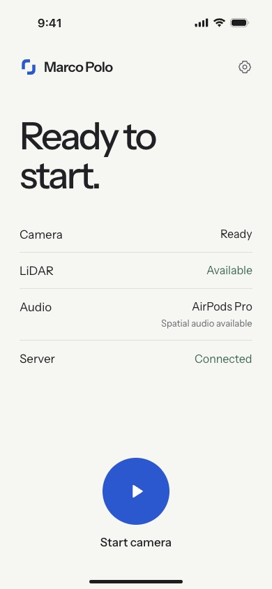

# iPhone designs

The approved **V3 · iOS — Ready** artboard is in the [Marco Polo Paper file](https://app.paper.design/file/01M55Z1GDRDK8E0XJMJE99EECZ/p-1-0), above the earlier designs.

This is a Paper mockup with example hardware values, not a simulator screenshot. The native implementation reads real state in `Marco/App/ContentView.swift`; `Marco/Design/Theme.swift` holds shared colours, custom fonts and the mark. Native Running, denied, unsupported and interruption states reuse the same layout.

`ready.png`, `running.png` and `attention.png` preserve the earlier design for reference. [paper-artboards.json](paper-artboards.json) records both sets of source artboards.
